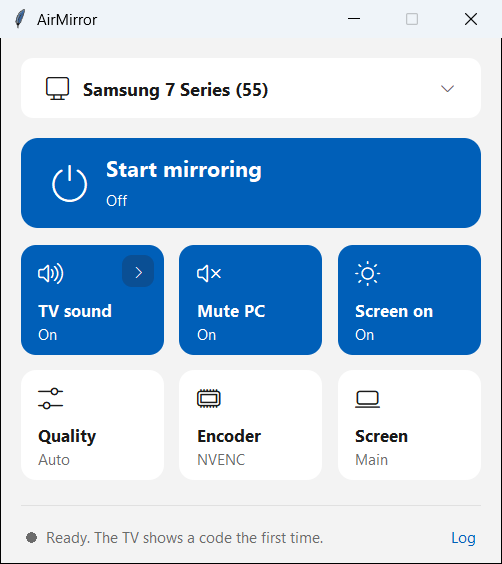
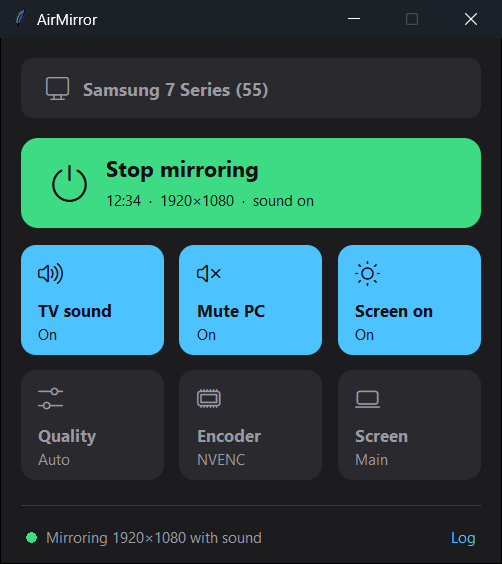
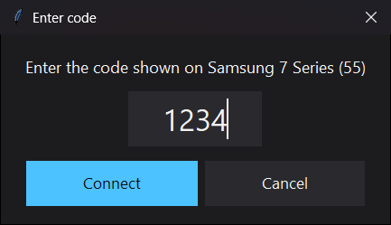

# airplay-windows

Mirror your whole Windows desktop, with sound, to a Samsung TV over AirPlay. It uses the same
AirPlay receiver the TV uses for iPhone mirroring, so it works on TVs where Windows' own
Miracast (`Win + K`) finds the TV but can't connect. Everything here is free and open source.

The AirPlay sender is [open-airplay](https://github.com/parsakhaz/open-airplay), a Windows port
of [doubletake](https://github.com/omarroth/doubletake). This repo builds it from a pinned commit,
adds two Samsung fixes in [`patches/`](patches/), and wraps it in setup scripts and a small
window, AirMirror.

| Ready to mirror (light theme) | Mirroring (dark theme) |
|---|---|
|  |  |

## Status

Mirroring works on a Samsung 7 Series 55" (model UNU710D, 2018): a live 1920x1080 desktop at
30 fps, the PC's sound from the TV speakers, and, with the TV set to **First Time Only**, no
pairing code after the first connection.
That is the only TV tested so far.

That result came from the command line. The AirMirror window passes its tests against a
simulated sender but hasn't run against the TV yet. [`PLAN.md`](PLAN.md) tracks what is verified
and what comes next.

## Before you start

You need:

- Windows 10 or 11, with `git` and `winget`. Setup installs Go 1.27.0 and FFmpeg 9.0.2 with
  `winget` if they are missing.
- Python 3.12 or later, for the AirMirror window. It uses only the standard library.
- A TV that mirrors from an iPhone with AirPlay. Samsung TVs from 2018 onward support it.
- The PC and the TV on the same home network. The PC can be on 5 GHz and the TV on 2.4 GHz, as
  long as both connect to the same router and not to a guest network.

By default, the TV shows a new code on every connection, and you type it in each time. To have
it ask only the first time, change the Samsung TV's own AirPlay settings. This repo can't change
them for you. With the TV remote, open **Settings > General > Apple AirPlay Settings** and set
**Require Code** to **First Time Only**.

## Set up

1. Clone the repo:

   ```bash
   git clone https://github.com/tonesjones/airplay-windows
   ```

2. In PowerShell, from the repo folder, run setup:

   ```bash
   .\setup.ps1
   ```

   Setup installs Go and FFmpeg with `winget` if they are missing, builds the pinned sender into
   `bin\open-airplay.exe`, and runs `shortcut.ps1` to add an **AirMirror** shortcut to the
   desktop and the Start menu. Windows may ask for admin approval while Go installs. If PowerShell refuses to run the script, run
   `powershell -ExecutionPolicy Bypass -File .\setup.ps1` instead. That bypasses the policy for
   this one run only.

You only run setup once. Later runs rebuild only when the pinned commit or the patches change.
Don't run setup while you're mirroring, because it rebuilds the sender that's running.

## Mirror your desktop

1. Wake the PC's screen. The PC can't capture its screen while the monitor is asleep.
2. Double-click the **AirMirror** shortcut on the desktop, or open it from the Start menu.

   If the shortcut is missing, run `.\shortcut.ps1` from the repo folder to add it. Rerun it
   after you move the folder. You can also open the window from the repo folder with
   `py -3 -m airmirror`.

3. Check that the box at the top shows your TV. If you have more than one AirPlay device, click
   the box and pick the TV.

   If the box says **No TV found yet**, make sure the TV is on, then click the box:

   - Under **Worked before**, pick your TV. The menu lists TVs you've mirrored to before.
   - If your TV isn't listed anywhere, choose **Type the TV's IP address…**. On a Samsung TV,
     the address is under **Settings** > **General** > **Network** > **Network Status** >
     **IP Settings**.

   In both cases the window asks the TV for its AirPlay port directly, so it connects even when
   the TV doesn't announce itself.
4. Click **Start mirroring**.
5. The TV shows a 4-digit code. Type it into the window and click **Connect**.

   How often this step comes back depends on **Require Code** in the Samsung TV's
   **Apple AirPlay Settings** (see [Before you start](#before-you-start)). With **Every Time**, the default, the TV asks on every
   connection. With **First Time Only**, the sender saves the pairing in Windows Credential
   Manager, and later connections skip this step.

   

6. The first time you mirror, Windows Firewall asks about `open-airplay.exe`. Allow it.
   Mirroring needs the TV to reach the PC.

The TV switches to your desktop within a few seconds, and the bar turns green. Sound plays from
the TV. The TV keeps its own volume, so use the TV remote to change it.

To stop mirroring, click **Stop mirroring**. Closing the window also stops mirroring.

### Change what the tiles do

Click a tile to turn it on or off, or to pick a value. The window remembers your TV and your
choices in `%APPDATA%\AirMirror\settings.json`.

After a session ends, the Samsung can stop announcing itself on the network for a few minutes.
The window still shows the last TV you mirrored to. When you click **Start mirroring**, it asks
that TV for its AirPlay port directly, and it keeps asking until the TV answers or you click
**Cancel**.

| Tile | What it does |
|---|---|
| **TV sound** | Sends the PC's sound to the TV. To capture a device other than the default output, click the arrow on the tile. |
| **Mute PC** | Mutes the PC's speakers while mirroring, then restores them. The TV still gets the sound. |
| **Screen on** | Keeps the PC's monitor awake while mirroring, so the TV picture doesn't freeze. |
| **Quality** | **Auto** lets the TV choose. **Smooth** sends 30 fps at 8 Mbps. **Weak Wi-Fi** sends 30 fps at 3 Mbps. |
| **Encoder** | **NVENC** uses an NVIDIA graphics card. **Software** uses the CPU. **Auto** lets the sender choose. On a PC with an NVIDIA driver, the window starts on **NVENC**. |
| **Screen** | Picks which monitor to mirror. |

You can't change **TV sound**, **Quality**, **Encoder**, or **Screen** while mirroring. To
change them, stop mirroring first. **Log** at the bottom opens the sender's log.

### Mirror from the command line

1. Start the sender:

   ```bash
   .\bin\open-airplay.exe -display 0 -hwaccel nvenc
   ```

   Use `-hwaccel nvenc` on an NVIDIA graphics card. On other cards, leave the flag out.
2. Pick your TV from the list that the sender prints.
3. If the TV shows a code, type it into PowerShell and press **Enter**.

To stop mirroring, press **Ctrl+C** in PowerShell.

To list your displays or the AirPlay devices on your network, run
`.\bin\open-airplay.exe -list-displays` or `.\bin\open-airplay.exe -list-receivers`.

## Fix common problems

**The TV isn't in the list.**
- Check that the TV is on.
- Check that AirPlay is on in **Settings > General > Apple AirPlay Settings**.
- Check that the PC is on the same network as the TV.
- If mirroring ended badly earlier, the TV can stop announcing itself. Turn the TV off and on
  with the remote, then wait 1 to 3 minutes before you try again.
- Don't want to wait? Click the TV box and choose **Type the TV's IP address…**. The window
  asks the TV directly, so it doesn't need the TV to announce itself.
- If your network is set to **Public**, Windows Firewall can block the replies that TV discovery
  needs. Allow the firewall prompt for `open-airplay.exe`, or switch the network to **Private**.

**The TV was found before, but now the connection goes to the wrong port.** The Samsung's AirPlay
port changes every time the TV restarts. The window finds the current port itself, so don't
type one in.

**The TV shows no picture, or the picture is black.** Wake the PC's monitor. The PC can't capture
its screen while the monitor is asleep.

**The window says it couldn't capture the screen, or the sender says the capture "failed startup
validation".** The PC's monitor is asleep. Move the mouse, then start again.

**The TV shows the code, but pairing fails.** After a wrong code, the TV drops the attempt.
Click **Start mirroring** again, or in PowerShell press **Ctrl+C** and start again. Then type
the new code the TV shows.

**The picture appears, then the TV goes back to its previous input.** On the Samsung that was
tested, this happened once with software encoding and not with NVENC. Restart the TV and set
the **Encoder** tile to **NVENC**, or use `-hwaccel nvenc`. The cause isn't confirmed yet.

**The bar says "Restart".** The sender stopped. Click the bar to start it again. If it stops
again, click **Log** and check the last lines.

**The TV is found, but the connection fails.** Windows Firewall may be blocking
`open-airplay.exe`. Open **Windows Security > Firewall & network protection > Allow an app
through firewall** and allow `open-airplay.exe`. If your Wi-Fi is set to **Public**, consider
setting it to **Private** under **Settings > Network & internet > Wi-Fi**, since this is your
home network.

## Limits

- One TV model is tested: the Samsung UNU710D. Other AirPlay TVs may need fixes like the ones in
  `patches/`.
- It uses the TV's native AirPlay only. It has no Miracast or browser mode.
- The window defaults to the NVENC encoder, which needs an NVIDIA graphics card. Software
  encoding (libx264) hasn't been tested on the TV since the first attempt, which failed.
- The app never changes the TV's volume. Use the TV remote.
- The PC monitor must stay awake. Windows turns it off after its idle timeout, and the TV picture
  then freezes. In the AirMirror window, the **Screen on** tile keeps the monitor awake while
  mirroring. From the command line, change the idle timeout in Windows' power settings.
- The tested TV accepts up to 1920x1080, so a 1440p desktop is scaled down to fit.
- Streaming apps that protect their video can show a black area on the TV.

## How it works

The sender finds the TV with mDNS and pairs with the code the TV shows. FairPlay isn't needed,
because Samsung TVs don't ask for it. FFmpeg captures the screen through Windows Desktop
Duplication (`ddagrab`) and encodes it as H.264. The sender captures the PC's sound with WASAPI
loopback and sends it as ALAC. Video and sound go to the TV encrypted with ChaCha20-Poly1305.

The two patches fix problems found on Samsung TVs:

- `0001-ntp-fallback.patch` ports doubletake PR #61. Some Samsung TVs advertise one clock-sync
  method (PTP) but only work with another (NTP), and the patch retries with NTP.
- `0002-never-set-receiver-volume.patch` stops the sender from setting the TV's volume.
  Unpatched, it set the volume to maximum.

## License

The code in this repo is MIT licensed (see [`LICENSE`](LICENSE)). `setup.ps1` builds
`bin\open-airplay.exe` on your PC from open-airplay, which is GPL-3.0, and from doubletake, which
is LGPL-3.0. Neither is distributed from this repo. The files in `patches/` carry their upstream
licenses.
